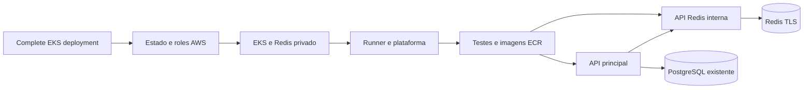

# Kairos Infra

Infraestrutura AWS e deploy centralizado das APIs Kairos com Terraform, EKS Auto Mode,
Redis gerenciado, ECR, Helm e GitHub Actions.

## Fluxo principal

**Actions > Complete EKS deployment > Run workflow > main**

[Guia de configuracao inicial](docs/full-deploy.md): Variables, Secrets, GitHub App,
permissoes AWS e limites do fluxo.

O workflow confere configuracao, prepara bucket/roles, provisiona a infraestrutura,
registra o runner privado, instala a plataforma Kubernetes, publica as duas APIs
e verifica conectividade privada, autenticacao e acesso ao Redis.

A primeira identidade AWS, PostgreSQL existente e certificado ACM validado precisam
ser fornecidos. DNS publico e migracoes do banco externo nao sao administrados por
este fluxo. Uma PR/CI nao cria recursos AWS.

## Servicos

| Servico | Origem | Acesso |
| --- | --- | --- |
| mobile-api | [kairos-springboot](https://github.com/KairosApplication/kairos-springboot) | HTTPS via ALB. |
| redis-api | [kairos-data/redis](https://github.com/KairosApplication/kairos-data/tree/main/redis) | Somente interno, chamado pela API principal. |
| agent-api | Modelo futuro | Desabilitado. |

O cadastro services.json e compartilhado por Terraform, bootstrap e build/deploy.
Nao ha descoberta nem publicacao de todos os repositorios da organizacao.
A pasta redis/ da segunda API tem testes pytest e Dockerfile fallback neste repo.
As chamadas de negocio na principal precisam estar integradas na main do
kairos-springboot; mudancas locais nao sao publicadas por esta Action.



## Workflows

| Workflow | Uso |
| --- | --- |
| Complete EKS deployment | Caminho principal: primeira instalacao e atualizacao completa. |
| Plan and provision AWS infrastructure | Operacao avancada da infra; exige flags e roles configuradas separadamente. |
| Deploy connected services | Operacao avancada de aplicacoes; manual ou periodica, apos configuracao. |
| Validate infrastructure | Terraform simulado, scripts, Helm e build/testes reais da API Redis sem AWS. |
| Secret scan | Busca por segredos com saida mascarada. |

Tudo executa no kairos-infra. Nenhum workflow chamador, Secret AWS ou runner
precisa ser instalado nos repositorios das APIs ou no repo .github.

## Dados, disponibilidade e segredos

- PostgreSQL e externo. O fluxo nao cria nem migra o banco.
- Redis gerenciado: TLS, autenticacao, criptografia, duas AZs, replica e snapshots.
- Senha Redis write-only/ephemeral; valores runtime fora do plano/estado Terraform.
- Chave interna da API Redis gerada uma vez e compartilhada via Secrets Manager.
- CSI/Pod Identity entregam segredos aos pods. Mudanca de versao provoca rollout.
- Mobile: uma replica ate integrar o ajuste de concorrencia PostgreSQL da PR #31
  fechada. Redis API: duas replicas em nos distintos.
- Helm usa maxUnavailable=0, maxSurge=1, readiness e rollback em falha.
- O teste final confere acesso privado autenticado a API Redis e ao Redis.
  Ele nao substitui um teste do fluxo de negocio completo.
- Logs do control plane vao ao CloudWatch. Retencao central dos logs da aplicacao
  exige um coletor separado.

## Estrutura

| Caminho | Conteudo |
| --- | --- |
| terraform/production/ | Rede, EKS, ECR, IAM, Redis e runner privado. |
| terraform/bootstrap/ | Alternativa manual para preparar bucket de estado. |
| scripts/pipeline_bootstrap.py | Bootstrap idempotente usado pelo fluxo completo. |
| charts/kairos-api/ | Chart compartilhado das APIs. |
| environments/production/ | Values por servico. |
| examples/ | Dockerfiles fallback e policy inicial de bootstrap. |
| docs/full-deploy.md | Configuracao minima para um unico botao. |
| docs/automation.md | Operacao avancada dos workflows individuais. |
| docs/operations.md | Operacao e rollback. |

## Validacao sem AWS

Terraform 1.13.5, Helm 3.19.0, Python 3.12 e actionlint 1.7.7.

```sh
terraform fmt -check -recursive terraform
terraform -chdir=terraform/bootstrap init -backend=false -input=false -lockfile=readonly
terraform -chdir=terraform/bootstrap validate
terraform -chdir=terraform/production init -backend=false -input=false -lockfile=readonly
terraform -chdir=terraform/production validate
terraform -chdir=terraform/production test -no-color
python -m pip install -r requirements-dev.txt
python -m unittest discover -s tests -v
actionlint -shellcheck= .github/workflows/*.yml
```

Os applies dos testes Terraform sao simulados. Deploy real depende da configuracao
inicial e cria recursos cobrados: EKS, nos, Redis, NAT, ALB, runner, segredos e armazenamento.

## Contribuicao

Usar branches feat/, fix/, chore/, docs/, refactor/ ou test/, sem prefixo codex/.
Commits em ingles no formato type(scope): description. Manter guias e
[wiki](https://github.com/KairosApplication/kairos-infra/wiki) alinhados apos o merge.
Licenca [MIT](LICENSE).
